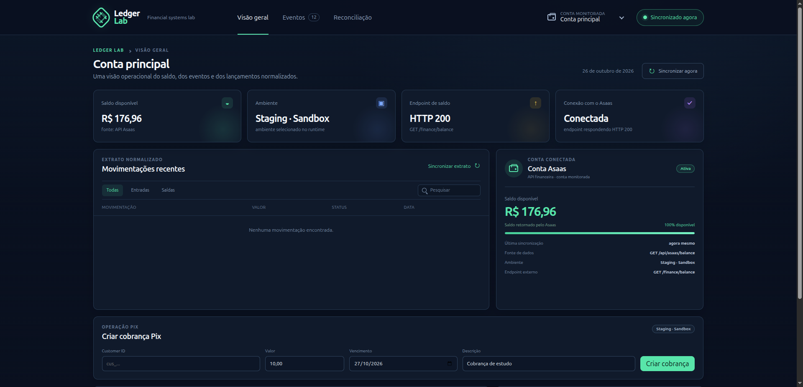

# Fintech Pix Lab

Laboratório de estudo em Java 21, Spring Boot e integração com a API Pix do
Asaas. O foco é aprender HTTP, testes, configuração e integrações financeiras.

CQRS, Event Sourcing e Event-Driven ficam fora deste projeto e serão estudados
em repositórios separados.

## Status

Projeto finalizado como laboratório de estudo: a integração com o Sandbox do
Asaas (saldo, extrato, cobrança Pix, QR Code e transferência) está funcionando,
protegida pelo header `X-Api-Key`. A evolução de integrações financeiras segue
em outro projeto.



## Estrutura

```text
server/  Java 21 + Spring Boot + cliente Asaas
web/     dashboard React
docs/    arquitetura, integração e backlog
```

## Executar

O Maven roda dentro do Docker:

```bash
./scripts/run-server.sh
```

O comando usa `server/.env.local` e inicia o server na porta `9090`. Para usar
produção explicitamente:

```bash
./scripts/run-server.sh production
```

Para testar o Sandbox do Asaas explicitamente, use a chave armazenada em
`server/.env.staging`:

```bash
./scripts/run-server.sh staging
```

Se saldo e extrato retornarem `upstreamStatus: 401`, a chave do Sandbox foi
rejeitada; gere outra no painel do Sandbox e atualize apenas esse arquivo.
Nunca use a chave de produção para esse teste.

Verifique se o server está funcionando:

```bash
curl http://localhost:9090/api/health
curl http://localhost:9090/actuator/health
```

## Configuração do Asaas

Crie uma API key no [Sandbox do Asaas](https://sandbox.asaas.com/) e configure
`server/.env.local`:

```dotenv
SERVER_PORT=9090
ASAAS_ENABLED=true
ASAAS_ENVIRONMENT=SANDBOX
ASAAS_BASE_URL=https://api-sandbox.asaas.com/v3
ASAAS_API_KEY=sua-chave-do-asaas
ASAAS_INTERNAL_API_KEY=um-segredo-ascii-diferente
```

Gere o segredo interno com `openssl rand -hex 32`. Ele precisa ser diferente da
chave do Asaas. A chave do Asaas é enviada no header `access_token`. Nunca
versione arquivos `.env`. Sandbox e produção usam contas e chaves separadas.

Se `ASAAS_ENABLED=true` e `ASAAS_INTERNAL_API_KEY` estiver vazio, ou for igual
à `ASAAS_API_KEY`, a aplicação não sobe. Isso vale para Sandbox e produção:
com a integração ligada, as rotas financeiras não podem ficar abertas.

`./scripts/run-server.sh staging` e `./scripts/run-server.sh production`
recusam iniciar se `ASAAS_API_KEY`, `ASAAS_BASE_URL` ou
`ASAAS_INTERNAL_API_KEY` estiverem vazios no arquivo de ambiente
correspondente (`server/.env.staging` ou `server/.env.production`).

## Autenticação da API interna

As rotas `/api/asaas/**` exigem o header `X-Api-Key` com o valor de
`ASAAS_INTERNAL_API_KEY`. Sem o header, ou com o valor errado, a resposta é
`401` em JSON. `/api/health` e `/actuator/health` continuam públicos.

```bash
curl -s http://localhost:9090/api/asaas/balance \
  -H "X-Api-Key: $ASAAS_INTERNAL_API_KEY"
```

No dashboard, copie `web/.env.example` para `web/.env.local` e defina
`VITE_ASAAS_INTERNAL_API_KEY` com o mesmo valor. O Vite embute essa variável
no bundle do browser: ela protege quem chama a porta `9090` sem o header, mas
não esconde o segredo de quem abre o dashboard. Não coloque a API key do Asaas
nessa variável.

## Endpoints

Com `ASAAS_ENABLED=true`:

```text
GET  /api/asaas/balance
GET  /api/asaas/statement?from=2026-09-29&to=2026-09-29
POST /api/asaas/payments/pix
GET  /api/asaas/payments/{paymentId}/pix-qrcode
POST /api/asaas/transfers/pix
```

Exemplo de cobrança Pix:

```bash
curl -X POST http://localhost:9090/api/asaas/payments/pix \
  -H 'Content-Type: application/json' \
  -H "X-Api-Key: $ASAAS_INTERNAL_API_KEY" \
  -d '{
    "customer": "cus_exemplo",
    "value": 10.00,
    "dueDate": "2026-10-01",
    "description": "Cobrança de estudo"
  }'
```

## Testes

```bash
docker run --rm -it \
  --user "$(id -u):$(id -g)" \
  -e MAVEN_CONFIG=/tmp/maven \
  -v "$PWD/server:/workspace" \
  -w /workspace \
  maven:3.9-eclipse-temurin-21 \
  mvn verify
```

Os testes não usam credenciais nem fazem chamadas reais ao Asaas.

## Documentação

- [Integração com Asaas](docs/asaas-integration.md)
- [Arquitetura](docs/architecture.md)
- [Stack](docs/stack.md)
- [Backlog de estudo](docs/issues.md)
- [Preparação para AWS EC2](docs/deploy-ec2.md)
- [Documentação oficial do Asaas](https://docs.asaas.com/docs/visao-geral)
